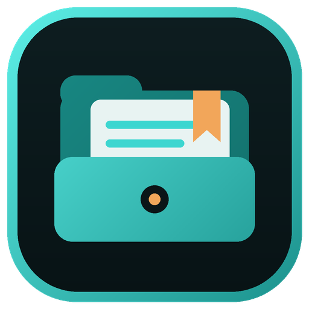
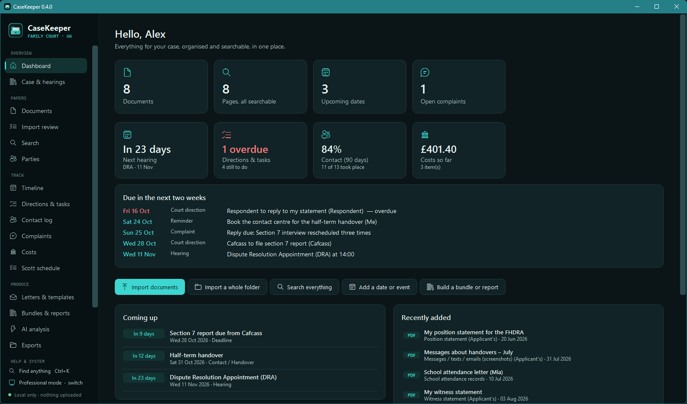
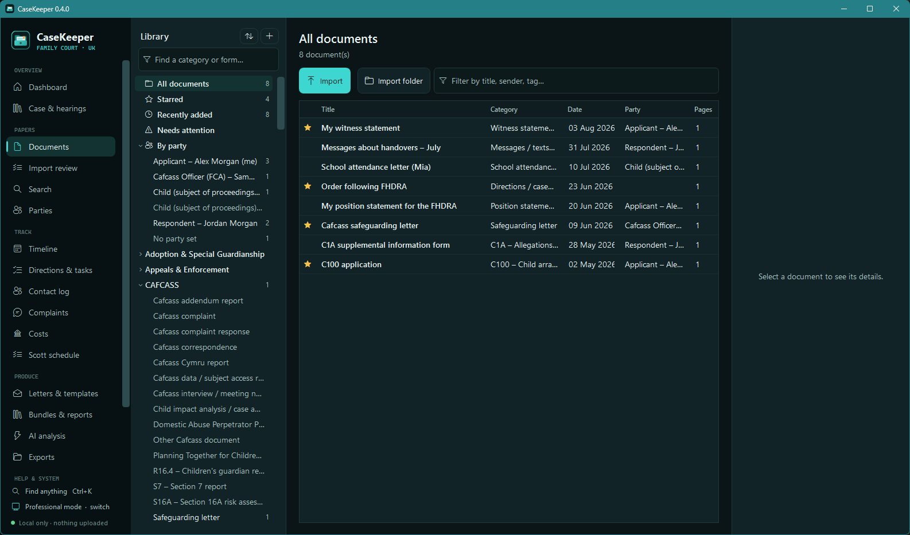
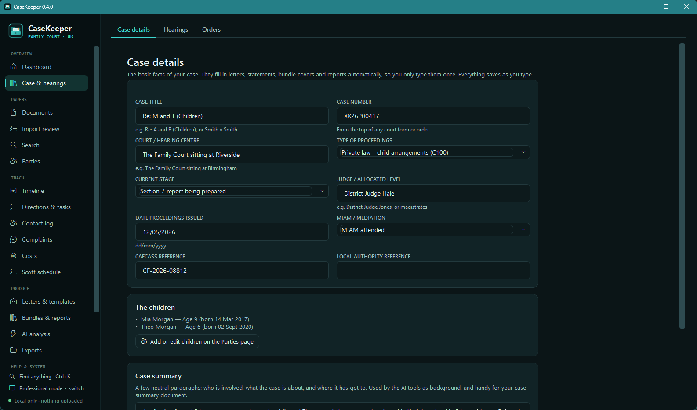
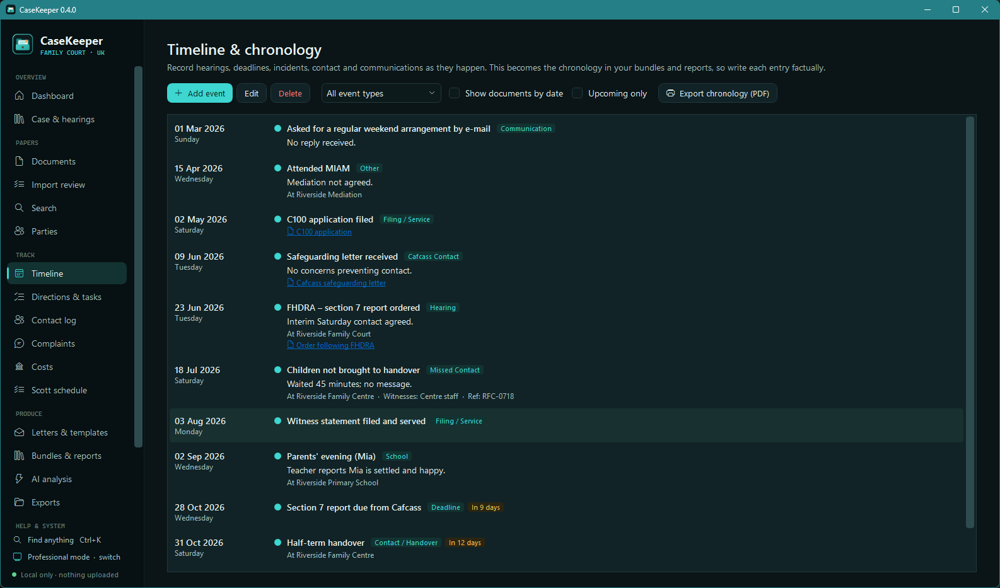
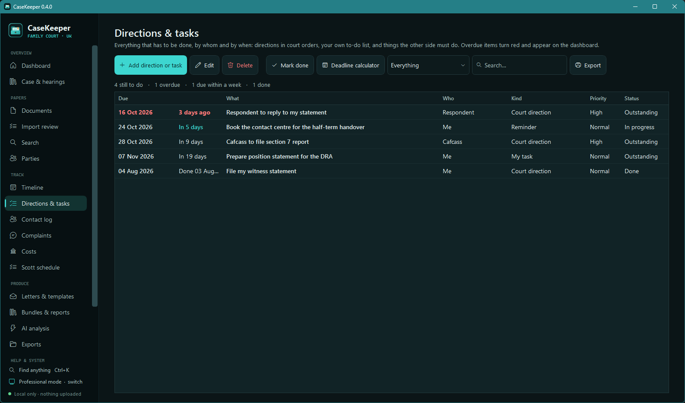
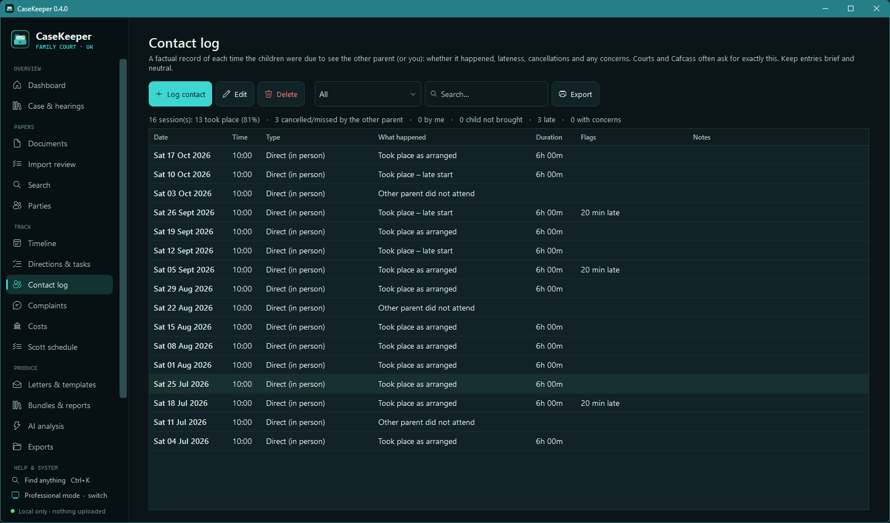
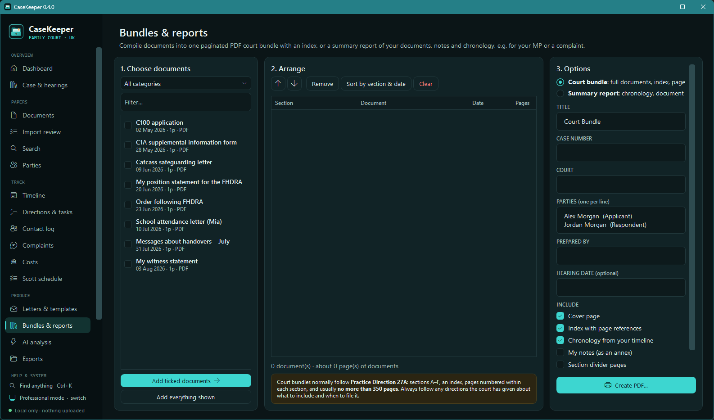

<p align="center"></p>

<h1 align="center">CaseKeeper</h1>

<p align="center">
  <b>Family court documents, organised and private.</b><br>
  <a href="../../releases/latest">Download</a> ·
  <a href="https://apps.microsoft.com/detail/9PG5PJPHCXXF">Microsoft Store</a> ·
  <a href="USER-GUIDE.md">User guide</a> ·
  <a href="CHANGELOG.md">What's new</a> ·
  <a href="SUPPORT.md">Help</a>
</p>

<p align="center">
  
  
  
  <a href="LICENSE"></a>
  
</p>

<p align="center"></p>

A private Windows app for running a family court case in England & Wales: documents, hearings and orders,
directions and deadlines, a contact log, costs, letters and statements on your own letterhead, court bundles,
a built-in guide to the family courts, and optional AI analysis – on your own computer, or with a cloud AI you
choose.

**Everything stays on your own computer.** Documents are copied into a local library, text recognition uses the
engine built into Windows, and nothing is uploaded anywhere unless you choose a cloud AI. The optional AI talks to an
Ollama server you choose – normally your own PC – or, if you set one up, to Anthropic, OpenAI or Microsoft Foundry:
then names and personal details are masked first, and nothing is sent until you agree. *Check for updates* only
downloads, and only when you ask.

> CaseKeeper is an organising tool. It does not give legal advice, and nothing it produces replaces advice from a
> solicitor, barrister or advice service.

Built for two kinds of user: a parent handling their own case (**Simple** mode – the essentials in plain English)
and a legal professional, McKenzie friend or power user (**Professional** mode – every tool, keyboard-driven).

## Install

**Microsoft Store (recommended):** [get CaseKeeper from the Store](https://apps.microsoft.com/detail/9PG5PJPHCXXF).
Microsoft signs it, it updates itself, and Windows shows no warning.

**Installer:**

1. Download `CaseKeeper-Setup-vX.Y.Z.exe` from the [latest release](../../releases/latest).
2. Run it. Windows may show **"Windows protected your PC"** because the installer isn't code-signed yet. Click
   **More info → Run anyway**. (See [RELEASING.md](RELEASING.md#the-smartscreen-warning) for why.)
3. The installer needs nothing else installed: it ships with its own copy of .NET.

Both use the same library, so you can switch between them without losing anything.

**Check your download.** Each release lists SHA-256 checksums in `SHA256SUMS.txt`. In PowerShell:

```powershell
Get-FileHash .\CaseKeeper-Setup-v0.6.1.exe -Algorithm SHA256
```

The result should match the line for that file exactly. If it doesn't, don't run it.

**Requirements:** 64-bit Windows 10 version 1809 or newer, or Windows 11. About 300 MB of disk space for the
program, plus whatever your documents take. Optional: [Ollama](https://ollama.com) for the AI tools; Microsoft Word
or LibreOffice to keep Word-template designs in PDF exports.

To upgrade, use *Settings → Updates → Check for updates* (from 0.5.0), or run the newer installer. Either way the
old version is replaced in place and **your documents, notes and settings are left exactly as they were**. In-app
updates are signed twice – ECDSA P-256 and post-quantum ML-DSA-65 – and CaseKeeper installs nothing those
signatures don't vouch for.

## What it does

**Your papers**
- **Import** PDFs, photos and scans, Word and text files by button or drag and drop. Originals are never changed.
- **Bulk Case Import** – bring in a whole case folder and its subfolders: preview everything first, skip duplicates by
  fingerprint, keep the original folder paths, read the text, then (optionally) let your local AI suggest categories,
  hearings, dates, directions and other records. Every suggestion cites its page and wording and waits in
  **Import review** for you to approve, edit or reject; nothing reaches the case without your approval. Pause and
  carry on any time, even after closing the app.
- **~470 categories** covering the family courts: every C-form and supplement, FL401/403/407/415, FGM001, FL701,
  divorce and financial remedy forms (D8, D84, D36, D81, Form A–H1, P–P2, ES1/ES2), appeals (FP161, FP162, N161),
  EX160/EX107, orders, Cafcass, local authority and public law, adoption/SGO, police, health, education, experts,
  mediation, legal aid and costs, international cases and more. Find one by typing any word or form code; sort A–Z,
  by code or by use.
- **Explorer-style management** – right-click menus everywhere, drag and drop between the list and the tree,
  rename, move, tag, exhibit numbering, column choice, smart folders and Deleted items with restore.
- **Search everything**, including the words in scanned pages (Windows OCR, run in parallel on capable PCs).

**Your case**
- **Case details, hearings and orders** – with countdowns, hearing-preparation checklists and an order register.
- **Directions & tasks** – who must do what by when, overdue warnings, and a **deadline calculator** that knows
  England & Wales bank holidays and the FPR way of counting days.
- **Timeline** with locations, witnesses and police/incident references; **contact log** with attendance statistics;
  **complaints** tracker; **costs**; **Scott schedule**.

**Your documents out**
- **Letters, statements and position statements** from built-in UK templates, with fields that fill themselves in,
  a live preview, and export to **Word, PDF or HTML**, print, or save into the library.
- **Letterheads** (three styles, your logo and colours) or **your own Word letterhead/templates** (.docx/.dotx),
  filled in with your case details while keeping their design.
- **Court bundles** in the style of Practice Direction 27A, and summary reports.

**Help and analysis**
- **UK Family Law Guide & FAQ** – searchable, plain English, with a glossary – and a full how-to for the app.
- **Help assistant** – ask "how do I…?" and get step-by-step directions with buttons that open the right screen,
  grounded in a map of the app and the user guide (local AI; only the question is sent).
- **Optional AI: local (Ollama) or cloud** – summaries, chronologies, issues, inconsistencies, welfare-checklist
  mapping, safeguarding and more, over any selection of documents, with map-reduce for large sets. Every prompt is
  editable; GPU/CPU, threads and context size are configurable.
- **One-click AI set-up** – install Ollama and the quick model, or paste a key for **Anthropic (Claude)**, **OpenAI
  (GPT)**, **Claude on Microsoft Foundry** or **OpenAI on Microsoft Foundry** and press *Connect*. Choose the model and
  reasoning effort; the default is quick and low-cost (Claude Haiku 5.5 / GPT-6 Luna, low effort).
- **Masking and a pre-send review for cloud AI** – names, contact details, NI, case, bank and card numbers, dates of
  birth and addresses are replaced with tags before sending and put back on your PC; a review screen shows where it
  goes, what's masked and which documents couldn't be masked well (read those locally, skip them, or send anyway).
- **Duplicates & versions** – finds copies and versions of the same document by their words (a PDF and a Word copy, a
  draft and its final), shows which is newest and why, and what changed, sentence by sentence.

**Safety**
- **Audit trail** of every change (old → new values), chained with SHA-256 fingerprints so tampering is detectable.
- **Error log** with on-screen references, free of personal data.
- **Optional password protection** – AES-256 for the database, documents, snapshots and saved exports – with
  auto-lock, lock-with-Windows and a one-click **Maximum security** mode.
- **Daily snapshots**, integrity checks, full **backups** (optionally encrypted) and a settings & templates file.
- **Signed in-app updates** (website version): check, verified download, backup prompt, install, and a check
  afterwards that the new version is running. Optional weekly or daily checks, off by default.
- Light and dark themes in the DarkCipher Systems style.

See the full **[user guide](USER-GUIDE.md)**.

## Screenshots

All names, numbers and documents shown are invented.

| | |
|---|---|
|  |  |
| **Documents** – the library, categories and preview | **Case details** – parties, court and stage |
|  |  |
| **Timeline** – events with locations and witnesses | **Directions & tasks** – who must do what, by when |
|  |  |
| **Contact log** – attendance and statistics | **Court bundles** – paginated, indexed PDFs |

## Documentation

| | |
|---|---|
| [User guide](USER-GUIDE.md) | Everything the app does, step by step |
| [Bulk Case Import](docs/BULK-IMPORT.md) | Importing a whole case folder and reviewing AI suggestions |
| [Changelog](CHANGELOG.md) | What changed in each version |
| [Microsoft Store packaging](docs/STORE.md) | Building and submitting the Store package |
| [Releasing](RELEASING.md) | Cutting a new version |
| [Tests](tests/README.md) | What the test programs check |
| [Security](SECURITY.md) | How data is protected, and how to report a problem |
| [Contributing](CONTRIBUTING.md) | Ground rules and how to build |

## Where your data lives

By default `%LOCALAPPDATA%\CaseKeeper` for the website installer, or `%USERPROFILE%\CaseKeeper` for the Microsoft
Store version – the database (`casekeeper.db`), copies of your imported files (`Files\`), daily snapshots
(`Snapshots\`) and anything you export into the library (`Exports\`). Logs go to `%LOCALAPPDATA%\CaseKeeper\Logs`
(the Store version keeps its logs and settings in its own app folder, which Windows removes on uninstall). The library
sits outside the program folder, which is why upgrading and uninstalling leave it alone. To delete it, use
*Settings → Factory reset → Remove all CaseKeeper data*, or say *Yes* when the website uninstaller asks. Move it elsewhere from *Settings → Your library*; when the library is password protected,
`vault.json` there holds the (useless without your password) key material.

Set the environment variable `CASEKEEPER_LIBRARY` to keep the library somewhere else, such as an encrypted drive.

## Building from source

```powershell
cd CaseKeeper
dotnet build                 # debug build
dotnet run                   # run it
```

Tests (see [tests/README.md](tests/README.md)):

```powershell
dotnet run --project tests\CaseKeeper.Tests.Docs -- "$env:TEMP\ck-test-output"
dotnet run --project tests\CaseKeeper.Tests.Data
dotnet run --project tests\CaseKeeper.Tests.BulkImport
dotnet run --project tests\CaseKeeper.Tests.Updates
```

To build a release installer, see [RELEASING.md](RELEASING.md).

## How it's put together

- `Models/` – documents, categories, parties, events, complaints, and the case records (hearings, orders,
  directions, contact, costs, Scott schedule, letters, templates, letterheads, AI reports)
- `Data/` – SQLite/SQLCipher with an FTS5 full-text index, a typed record store with automatic schema upgrades,
  the hash-chained audit trail, the category catalogue, and the Bulk Case Import working tables (`Database.BulkImport.cs`)
- `Services/BulkImport/` – Bulk Case Import: folder scanner, category candidates, the JSON Schema and checks for AI
  answers, the per-document analyser, cross-document checks, the resumable job runner and approvals (see
  [docs/BULK-IMPORT.md](docs/BULK-IMPORT.md))
- `Services/` – library, vault (AES-256-GCM), backup, OCR, PDF rendering, logging, performance profiles, session lock,
  deadlines, settings transfer, the signed updater (`Updater.cs`, `Pqc.cs`), the AI clients – Ollama, Anthropic, OpenAI and Foundry – and the masker (`Ai/`), the guide content (`Guide/`) and the document engine
  (`Documents/` – one model rendered to Word via OpenXML, PDF via PDFsharp, HTML and on-screen preview)
- `Views/` – WPF windows; `Views/Modules/` the case screens; `Views/Forms/` the shared record list and form
- `Themes/` – light and dark palettes · `installer/` – the Inno Setup script · `packaging/store/` – the
  Microsoft Store manifest and listing art · `tests/` – test programs

## Contributing, support and security

- Ideas and bug reports: [issues](../../issues/new/choose). Never include real case details.
- Pull requests are welcome; please read [CONTRIBUTING.md](CONTRIBUTING.md) first.
- Security problems: report privately, as described in [SECURITY.md](SECURITY.md).

## Credits

Built by **[DarkCipher Systems](https://darkciphersystems.com)**.

## Licence

MIT – see [LICENSE](LICENSE). Provided as-is, with no warranty. Third-party components:
[THIRD-PARTY-NOTICES.md](THIRD-PARTY-NOTICES.md).
